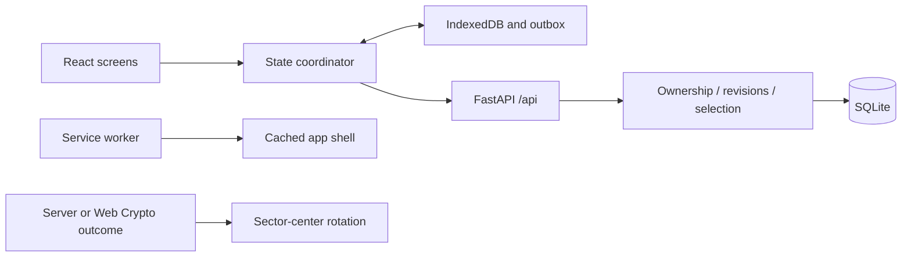

# Architecture

`screens/` contains the editor and library; `components/` holds wheel, dialog and PWA
controls. `App.tsx` composes the screens and share/result dialogs. UI copy lives in
`i18n.ts` and `customization.i18n.ts` in English; the Γύρνα. brand is unchanged.
HTML/manifest language is English; history uses en-GB date/time formatting.
Bundled templates support offline startup and are refreshed from the API. Both lists
start with Pick a name (Alex, Emma, James, Olivia, Noah, Sofia).
Greek/Latin Noto Sans variable fonts are bundled locally and precached, with no external
font request. Platform emoji fonts render emojis.
`lib/random.ts` uses Web Crypto rejection sampling; `lib/geometry.ts` independently
calculates sectors and angles. `lib/presentation.ts` projects up to 1,000 visible entries
out of up to 10,000 eligible entries and always includes the actual winning ID before
animation. Display-only duplicate collapsing never changes eligibility. Above 48 visible
entries, numbers refer to an expandable full-name legend; the editor pages by 200 rows.

Backend: `routes.py` handles HTTP, `schemas.py` validates inputs, `security.py` checks
cookies/ownership/CSRF, `services.py` owns revisions, serialization and random selection.
SQLAlchemy sessions are request-scoped. `BEGIN IMMEDIATE` serializes mutations so
revision checking, idempotency lookup and no-repeat updates share one transaction.
The database dependency uses function scope: commits complete before a success response
is sent, including when the process is terminated immediately after the response.

## Offline and concurrency

`state/store.ts` coordinates one IndexedDB document containing wheels, dirty flags,
mutation UUIDs, pending result IDs, workspace identity and any uncertain online draw.
IndexedDB v3 atomically adds a names starter to existing v1/v2 data exactly once,
using the shared factory in `state/wheel.ts`. Existing wheels and their content are
preserved. The starter becomes active unless a draw is pending. A blocked upgrade asks
the user to close older app tabs; connections created by this version close on upgrade.
New installations create just the names starter. This is a local data migration;
SQLite/API shapes are unchanged and existing customized popup messages are preserved.
Web Locks serialize operations across tabs; BroadcastChannel updates their views.
An in-memory overlay displays edits synchronously to preserve input caret position;
each overlay is removed only after its corresponding IndexedDB write completes, so
an older write cannot replace a newer keystroke on screen.
Unsubmitted form text/preferences use localStorage. The service worker caches only
the app shell; API responses never enter its cache.

1. Persist edits locally with the base server revision.
2. On startup, reconnect, manual save or idle interval, obtain the session/CSRF.
3. Recover an uncertain online draw using its original ID and revision.
4. PUT dirty snapshots with at most 1,000 pending offline results per batch. Mutation
   UUID plus payload digest makes identical retries safe; result UUIDs are also unique.
5. On a revision conflict, retain the server version and upload a separate copy of the
   local changes. Copied/imported history is marked client-reported (`offline`).
6. Refresh server snapshots. Deletion tombstones prevent stale resurrection; conflicting
   offline deletion preserves the newer server wheel.

Temporary blank fields remain local until editing finishes. Bulk blank lines are ignored.
Duplicate labels retain individual probability unless explicitly removed. Drafts with
0–1 options can be saved, but cannot spin. No-repeat can draw the last remaining entry.

An online request ID is persisted before sending. A lost response blocks further draws
until the same request is resolved. During animation, options/navigation are locked and
the wheel retains the pre-draw snapshot so its pointer matches the selected result.

## Session and sharing

Random 256-bit cookie: HttpOnly, SameSite=Lax, path `/api`, Secure in production. Only
its SHA-256 digest is stored. All private endpoints check ownership; mutations require
a workspace CSRF header and an allowed Origin when supplied. Public random share tokens
expose only title/options/no-repeat/customization, including explicitly shared images.
They never expose history or grant write access.
Deleting a wheel atomically revokes all its shares. New links/revocation require a server.

## Local launcher

The Windows launcher opens `/api/launch`, a public HTML-only endpoint serving the built
frontend index with no-store headers. Existing service workers exclude `/api` from
navigation fallback, so even an old cached app cannot intercept this entry. Hashed assets
load normally on the same origin; private cookies/IndexedDB and normal PWA caches remain.
This local entry requires the frontend dist folder beside the backend; `/` remains the
ordinary production/PWA entry when hosting the frontend separately.

## Customization

Home has a larger wheel with a right-hand Entries/Results sidebar at widths >=1024px;
on smaller screens the sidebar sits below the wheel. `components/WheelSidebar.tsx`
provides inline entry editing/add/remove, 100-entry pagination and result history with
source/time indicators. It uses the same revisioned edit path as the full editor and
locks all mutations during a draw. A completed draw selects Results automatically.
The sidebar displays a pre-draw wheel snapshot until animation completion. This freezes
history, its count and no-repeat markers while the real draw is already durably stored;
it does not delay or change server/IndexedDB writes. Completion (or failed draw cleanup)
releases the snapshot to show live data. Previous results remain browsable during a spin.
Each row has a pencil action; focusing its input selects the name, Enter blurs, and
edits continue through the same immediate local autosave path. Input text is 16px for
mobile readability; editing controls stay disabled while a draw is pending/animating.
Keyboard-operable tabs preserve their panels; unfinished add text is stored locally.
The separate Entries view retains the full editor, customization, sharing and templates.
Both editors stay mounted while hidden, using distinct labels/IDs and draft keys.

`components/Customize.tsx` holds a temporary draft until OK; cancellation discards it.
`customization.ts` defines versioned settings and bounded raster image import;
`customization.i18n.ts` contains its English UI copy. The same settings/images travel
through the existing revisioned outbox, sharing and backup paths. SQLite stores JSON
settings and optional option images. IndexedDB version 3 includes both local migrations.
`lib/audio.ts` synthesizes original sounds and provides immediate global mute/stop.
Eight spin sounds and eight result sounds use local tone/noise scores; completed audio
nodes are disconnected and removed while looping, keeping resource use bounded.
The desktop home uses the viewport width with a 340px sidebar 16px from the right edge.
Its stage grows up to 960px, constrained by viewport height and sidebar space. A bounded
left inset centers the wheel on the viewport when possible, keeping it clear of the
sidebar when space is limited. Small screens retain a centered, stacked layout.
The rim uses 96% of that stage with a thin border, leaving more area for the segments.
SVG label sizes depend on entry count and displayed label length; up to 10 entries use
24-unit text when space permits. Long labels shrink, and the numbered large-list mode
remains unchanged. Sector angles, palette settings and draw geometry are unchanged.
Short viewports reduce its size; the sidebar scrolls independently without stretching
the wheel's layout. Presentation hides the sidebar and keeps its dedicated wheel layout.
The stationary center button starts the same guarded draw flow as result actions and
supports native keyboard activation. With a custom center image its hit area is
transparent and its label sits just below the image, keeping small images visible.
While awaiting the next spin, `Wheel.tsx` uses Web Animations for a silent
120-second idle revolution without React updates each frame. Pause/resume and live
reduced-motion changes are respected; hidden screens/share dialogs and pending draws stop idle
motion. `lib/motion.ts` captures the actual rendered angle before cancelling idle motion.
The draw animation starts from that angle, still targeting the backend/offline winner.
After landing on the winner, idle motion resumes immediately, including behind the
result popup and while background sync runs. The recorded result/history never changes
because of idle motion. A wheel with visible entries can idle even when its draw button
is disabled; the next real draw captures its current angle as before.
Completed draws snapshot their settings; an ID-based durable removal queue runs after
five seconds, deferring while another draw is busy. Manual removal clears matching jobs.
Conflict/session-loss copies take their pending jobs with them; execution reads and
changes the latest IndexedDB state under the same Web Lock to prevent stale-tab removals.

## Upstream references

- [FastAPI credentialed CORS](https://fastapi.tiangolo.com/tutorial/cors/): explicit origins.
- [Vite PWA updates](https://vite-pwa-org.netlify.app/guide/auto-update): prompt updates
  avoid unannounced reloads while editing forms.
- [SQLite foreign keys](https://www.sqlite.org/foreignkeys.html): enabled per connection.
